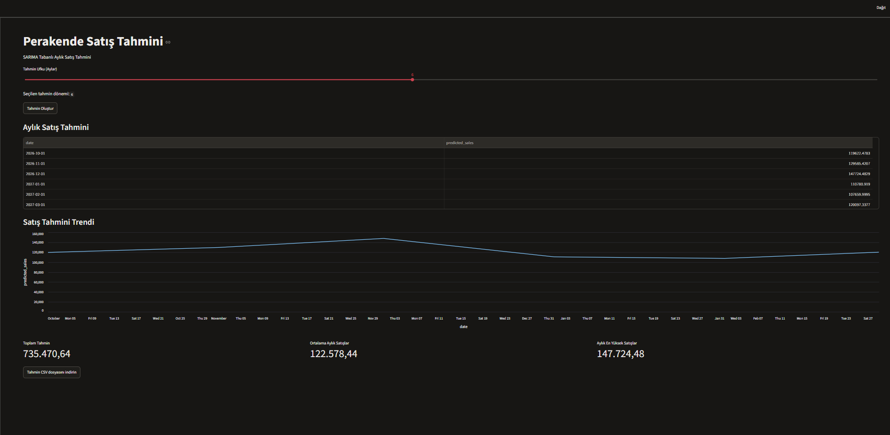
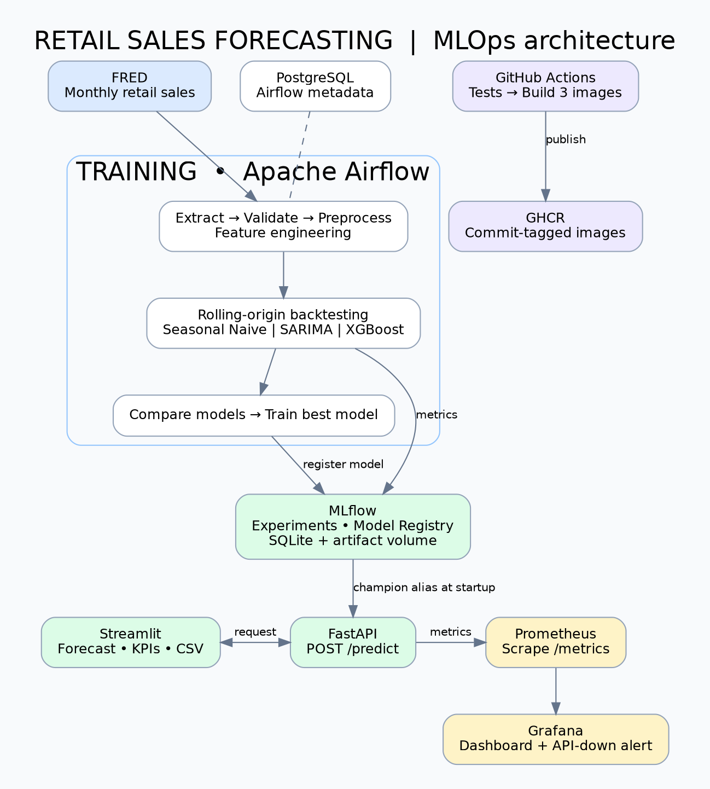
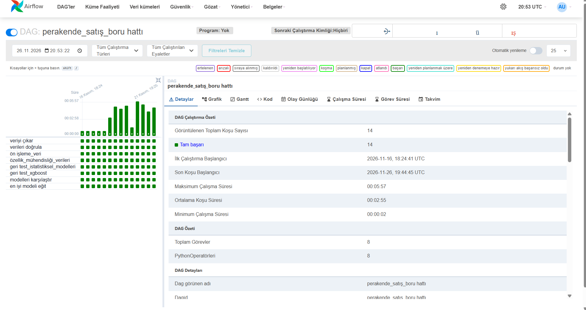
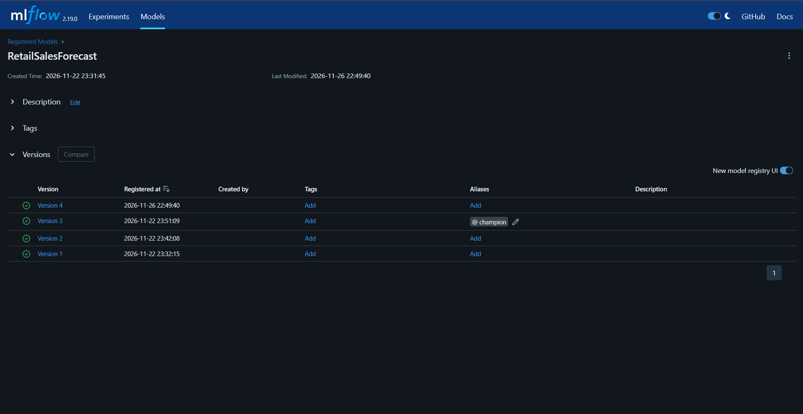
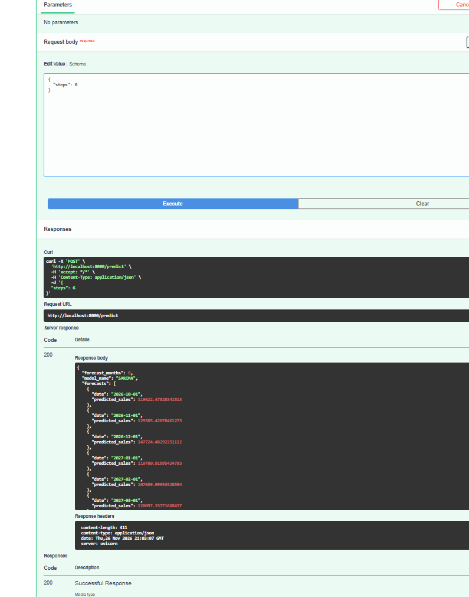
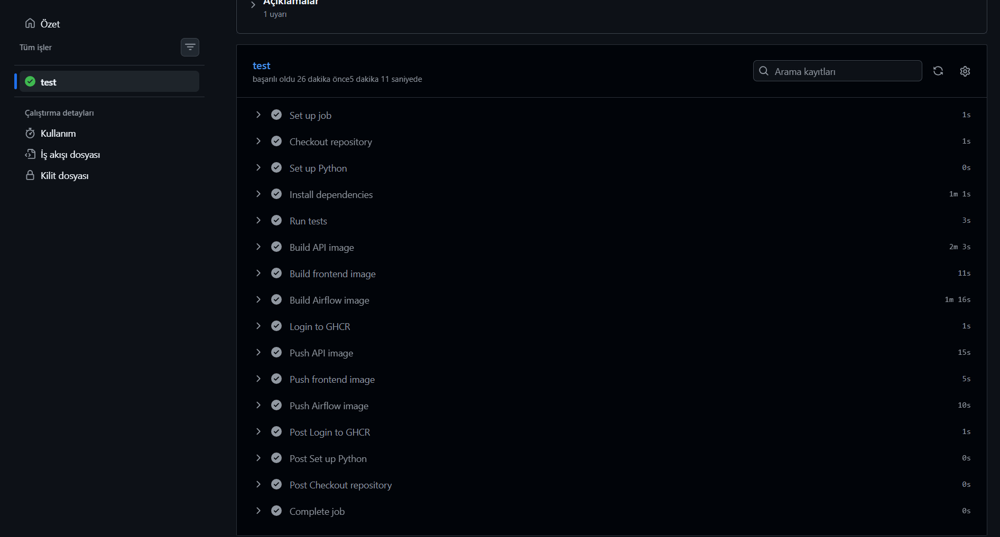
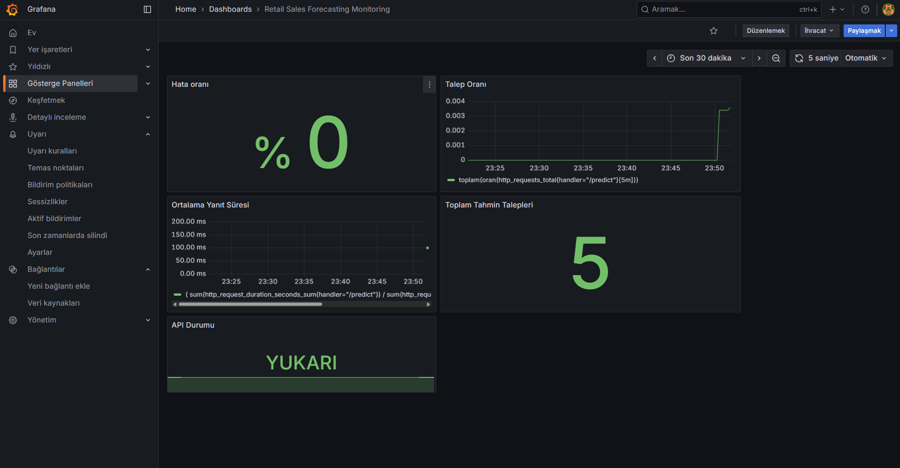
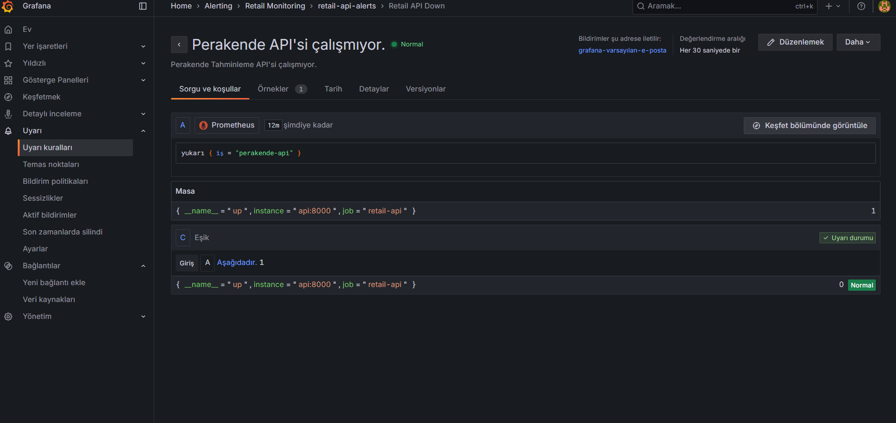

# Retail Sales Forecasting | End-to-End MLOps

    

A containerized, end-to-end machine learning system for monthly retail sales forecasting. The project covers data ingestion, validation, feature engineering, time-series model evaluation, experiment tracking, model registration, API serving, automated testing, container image publishing and operational monitoring.

## Application preview



The interactive Streamlit application supports a 1–12 month forecast horizon, monthly predictions, trend visualization, aggregate KPIs and CSV export.

## Project highlights

| Metric | Observed result |
|---|---:|
| SARIMA backtesting sMAPE | 3.91% |
| Successful Airflow runs | 14 / 14 |
| Airflow tasks | 8 |
| Average DAG runtime | 2m 55s |
| Automated unit and integration tests | 13 passed |
| Registered model versions | 4 |
| Published service images | 3 |

Results are development-environment observations, not production SLAs or guarantees of future forecasting accuracy.

## System architecture



Docker Compose runs the local services. Airflow orchestrates training; MLflow stores experiment results and model artifacts; FastAPI loads the registered champion model at startup. Streamlit calls the prediction endpoint. Prometheus collects API metrics and Grafana visualizes service health. GitHub Actions builds and publishes images independently of local deployment.

## Technology stack

| Layer | Technologies |
|---|---|
| Data processing | Python 3.11, Pandas, NumPy |
| Forecasting | Statsmodels SARIMA, XGBoost, Seasonal Naive |
| Orchestration | Apache Airflow, PostgreSQL |
| Model lifecycle | MLflow 2.19.0, model registry, aliases |
| Serving | FastAPI, Pydantic, Uvicorn |
| UI | Streamlit |
| Infrastructure | Docker, Docker Compose |
| CI and delivery | Pytest, GitHub Actions, GHCR |
| Observability | Prometheus, Grafana |

## Data and model development

Monthly retail sales observations are retrieved from [FRED](https://fred.stlouisfed.org/). The pipeline validates and preprocesses observations before generating lag features (1, 3 and 12 months), shifted rolling averages (3 and 6 months), and calendar features. Lagged and shifted features avoid using future observations in training features.

Three forecasting approaches are compared using expanding-window, rolling-origin backtesting rather than random train/test splits:

- **Seasonal Naive:** seasonal baseline using the previous year's observations.
- **SARIMA:** seasonal autoregressive model with order (1,1,1) and seasonal order (1,1,1,12).
- **XGBoost:** feature-based regression with recursive multi-step forecasting.

### Observed model performance

| Selected model | MAE | RMSE | sMAPE |
|---|---:|---:|---:|
| SARIMA | 3,149.77 | 3,848.72 | 3.91% |

MAE and RMSE are expressed in the original sales-series scale. These are backtesting results, not an independent production evaluation or a direct comparison between registry versions 3 and 4.

## Airflow orchestration

The `retail_sales_pipeline` DAG includes eight PythonOperator tasks: extraction, validation, preprocessing, feature engineering, statistical-model backtesting, XGBoost backtesting, model comparison and best-model training. The DAG is currently triggered manually.



## MLflow experiment tracking and registry

Backtesting metrics are logged to MLflow. The selected SARIMA model is packaged as an MLflow PyFunc model and registered under `RetailSalesForecast`. Serving uses `models:/RetailSalesForecast@champion`, separating training from inference.



The captured registry contains four versions, with version 3 assigned the `champion` alias. New versions are not automatically promoted; promotion requires evaluation and manual approval. Restart the API after changing the alias to reload the selected model.

## FastAPI model serving

`POST /predict` accepts a forecast horizon from 1 to 12 months. Pydantic validates the input and the API returns dated sales predictions as JSON.

```bash
curl -X POST http://localhost:8000/predict -H "Content-Type: application/json" -d '{"steps":6}'
```



## CI/CD and container delivery

GitHub Actions runs unit and integration tests and builds Docker images for the API, frontend and Airflow. On pushes to main, images are published to GitHub Container Registry with latest and commit-based tags. Automated image publication is implemented; deployment to a remote production environment is not.



Run the scoped test suite locally:

```bash
python -m pytest tests/unit tests/integration -v
```

## Monitoring and alerting

Prometheus scrapes API metrics. Grafana displays API availability, prediction request count, request rate, average response time and server-error rate. Request counts and cumulative mean latency reset with the API process. Error rate may be undefined when there is no traffic.



The API-down alert checks `up{job="retail-api"}` every 30 seconds, with a one-minute pending period. The alert lifecycle was tested by stopping and restarting the API. Email notification delivery has not been configured or verified.



## Repository structure

```text
.
├── .github/workflows/ci.yml
├── api/                     # FastAPI and API Dockerfile
├── dags/                    # Airflow DAG
├── frontend/                # Streamlit and frontend Dockerfile
├── monitoring/              # Prometheus config and Grafana exports
├── src/                     # Data, feature, model and pipeline modules
├── tests/                   # Unit and integration tests
├── docs/images/             # Documentation screenshots and architecture
├── .env.example
├── config.py
├── docker-compose.yml
├── Dockerfile               # Airflow image
├── requirements.txt
└── run_pipeline.py
```

## Local setup

Prerequisites: Git, Docker with Compose v2, and Python 3.11 for local tests. From the repository root, copy `.env.example` to `.env` (PowerShell: `Copy-Item .env.example .env`) and replace placeholder passwords with suitable local credentials. Use URL-safe database credentials for the current connection-string configuration. Keep `.env` out of Git. Existing PostgreSQL volumes retain their initialized credentials.

Start the training infrastructure first:

```bash
docker compose up -d --build postgres mlflow airflow-init airflow-webserver airflow-scheduler
```

Open Airflow, trigger `retail_sales_pipeline` and wait for successful completion. In MLflow, verify the registered SARIMA model and assign the `champion` alias to the evaluated version. Then start serving and monitoring:

```bash
docker compose up -d --build api frontend prometheus grafana
```

| Service | Local URL |
|---|---|
| Airflow | http://localhost:8080 |
| MLflow | http://localhost:5000 |
| FastAPI Swagger | http://localhost:8000/docs |
| Streamlit | http://localhost:8501 |
| Prometheus | http://localhost:9090 |
| Grafana | http://localhost:3000 |

In Grafana, configure a Prometheus data source using `http://prometheus:9090`, import `monitoring/grafana/retail_dashboard.json`, and configure the alert using `monitoring/grafana/retail_alerts.yaml` as a reference. Adapt exported data-source UIDs to the local instance. Dashboard and alert provisioning is not automatic.

The setup sequence reflects the implemented architecture; a clean-machine bootstrap has not yet been independently verified. Services are intended for local use, not public network exposure.

## Limitations and future improvements

- Scheduled retraining and automated champion/challenger promotion are not implemented.
- Model signature and independent version-level evaluation remain improvement areas.
- Operational monitoring is implemented; data drift and delayed ground-truth performance monitoring are not.
- CI tests are scoped to unit and integration directories; SARIMA convergence warnings remain in synthetic-data tests.
- Production authentication, secret management, remote deployment and notification delivery require further work.

## Data attribution

Source: Federal Reserve Bank of St. Louis, FRED. Raw datasets and trained artifacts are not distributed with this repository. Consult the underlying series' source and usage terms before redistributing data.
